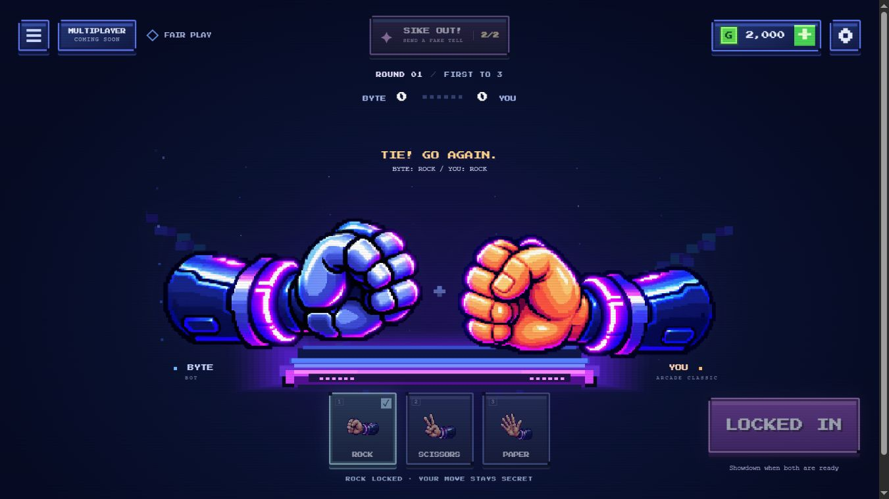
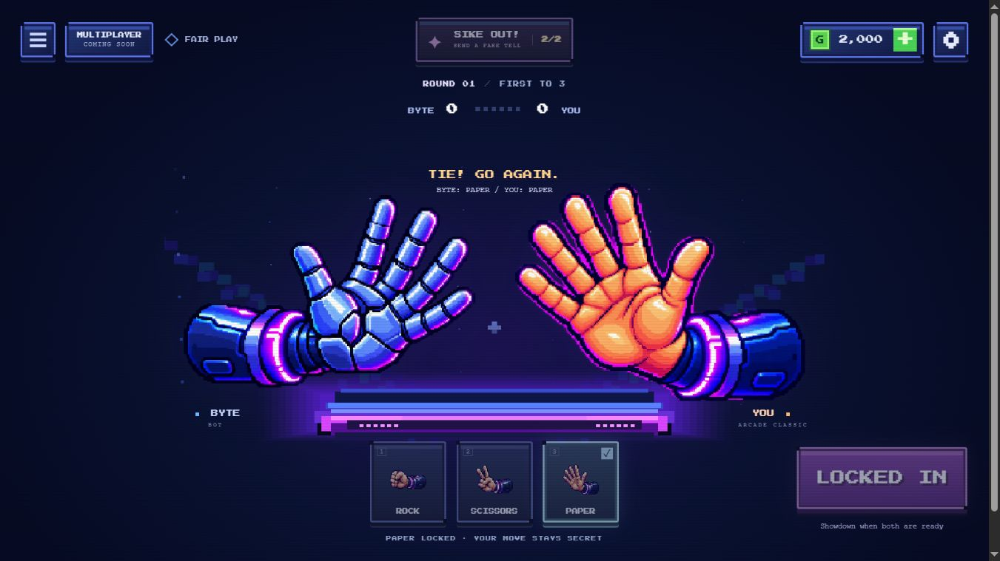
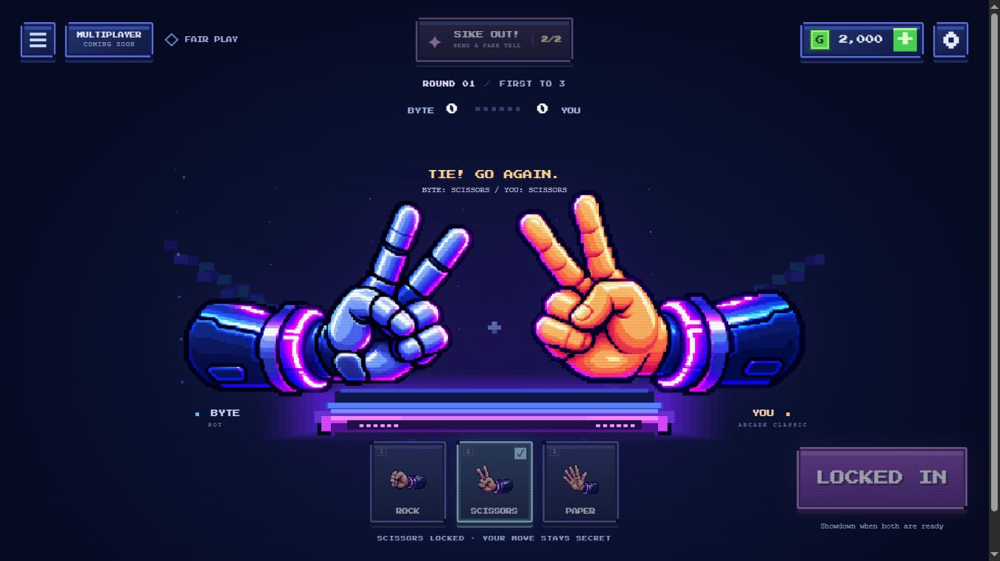

# Phase 2A approved hand integration

Review branch: `codex/phase-2a-approved-hands`. Requires approval before merging into `main`.

## Implementation

- Six supplied 768 x 768 RGBA runtime PNGs are deployed unchanged. BYTE uses blue robotic hands on the left; Arcade Classic uses orange hands on the right. Loaded PNGs are never mirrored.
- `src/render/hand-assets.js` provides shared asynchronous loading, explicit per-image readiness, caching, dimension validation and an eight-second timeout. Any missing image falls back independently to the original procedural hand without blocking play.
- `src/render/hands.js` shares artwork between arena, home and icons. Every arena pose uses the same square 224-unit camera; home uses a 360-unit camera. Icons trim transparent margins only. Pixel smoothing is disabled.
- `src/render/arena.js` and `src/render/home-hub.js` use the shared renderer. Existing idle/shake/SHOOT timing, reveal secrecy and reduced-motion behavior remain in their existing code paths.
- `src/main.js` refreshes icons after loading; `src/ui/bluff-alert.js` uses the shared icon renderer. Neon Circuit and Solar Flare keep their distinct procedural geometry and colors.
- A small presentation fix in `src/styles/phase2b.css` hides the expired timer/readiness labels while the round result is displayed, preventing overlapping text. It does not alter timer behavior.
- No changes to `src/core/`, `src/config.js`, save keys, economy, ownership, settings, tutorial progress or Phase 2B rules. No new dependencies, services or networking.

## Verification

`node --test`: **48 passed, 0 failed**, including all 39 existing tests and nine artwork tests covering mappings, image dimensions, readiness/cache behavior, partial errors, timeout/late events, no PNG mirroring, complete pose bounds, alternate skins and fallback rendering.

`node scripts/build.mjs`: successful. Runtime assets use module-relative URLs compatible with GitHub Pages repository subpaths. Only game files and runtime assets enter `dist/`; review screenshots, fixtures and source artwork masters are excluded.

Browser checks used the Chromium-based in-app browser at 1366 x 768, 768 x 1024 and 390 x 844. All six arena poses were inspected at desktop and mobile sizes, plus the tablet scissors pair. No horizontal page overflow was measured. Home customization, both purchased skins, and simulated total image-load failure were checked. The review and fallback pages reported no console warnings/errors. The unmodified production build also completed a normal paper selection, private lock, waiting state and paper reveal, with no console warnings/errors. Existing 40 GO Coins and Neon Circuit ownership/equipment remained present. All six asset requests under the `/dist/` subpath returned HTTP 200; SHA-256 comparisons confirmed every shipped PNG matches the supplied kit. Physical mobile devices, Safari and Firefox have not been tested.

## Screenshot method

The screenshots show the actual application UI, renderer and match engine in a generated review copy. Its isolated in-memory save owns all skins, and injected clocks/bot decisions hold a normal REVEAL for repeatable screenshots. The copy does not read or write player localStorage. These are controlled visual QA scenarios, not claimed random match outcomes. No review controls or forced outcomes are added to production.

Reproduce with:

```sh
node scripts/hand-art-review.mjs
node scripts/serve.mjs
```

Open `http://127.0.0.1:8000/output/hand-art-review/`, choose both poses and press SHOW REVEAL. Use HOME SHOWCASE for customization. Append `?art=failed` to exercise the procedural fallback. Production remains at `/` or `/dist/` after building.

## All six approved poses in the arena

### Rock: BYTE left, player right



### Paper: BYTE left, player right



### Scissors: BYTE left, player right



## Responsive and customization evidence

| Check | Screenshot |
| --- | --- |
| Mobile rock | [390 x 844](hand-art-review/mobile-rock.jpg) |
| Mobile paper | [390 x 844](hand-art-review/mobile-paper.jpg) |
| Mobile scissors | [390 x 844](hand-art-review/mobile-scissors.jpg) |
| Tablet scissors | [768 x 1024](hand-art-review/tablet-scissors.jpg) |
| Home customization | [Classic paper](hand-art-review/home-classic-paper.jpg) |
| Purchased Neon Circuit | [Arena](hand-art-review/alternate-neon-circuit.jpg) |
| Purchased Solar Flare | [Arena](hand-art-review/alternate-solar-flare.jpg) |
| Image loading disabled | [Playable fallback](hand-art-review/fallback-rock.jpg) |

No known artwork integration defects remain from these checks. The approved kit contains static poses; existing motion animates these complete images rather than inventing new animation frames. The live Pages site changes only after this branch is approved and merged.
