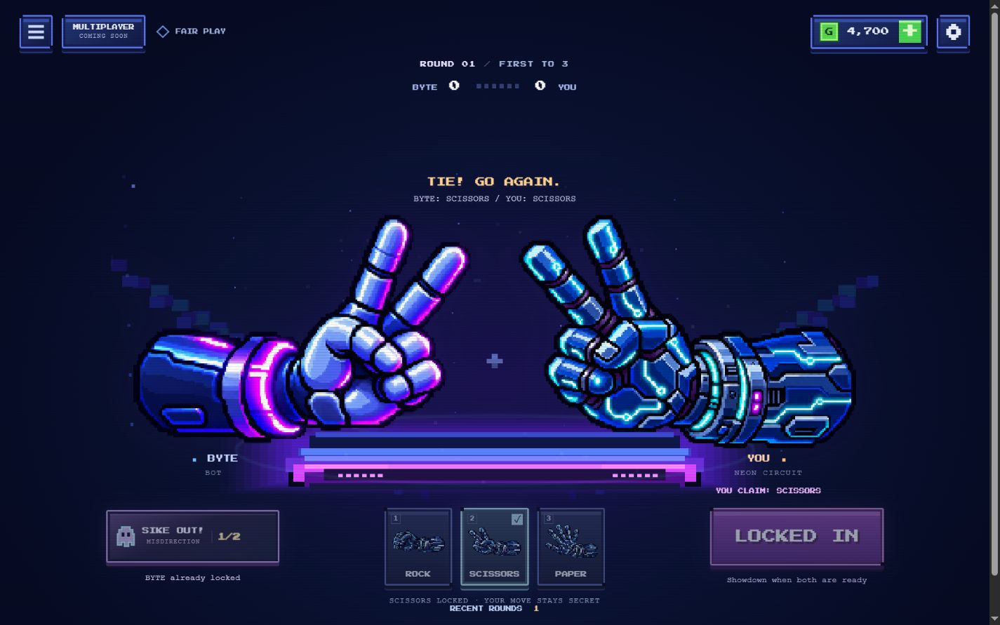
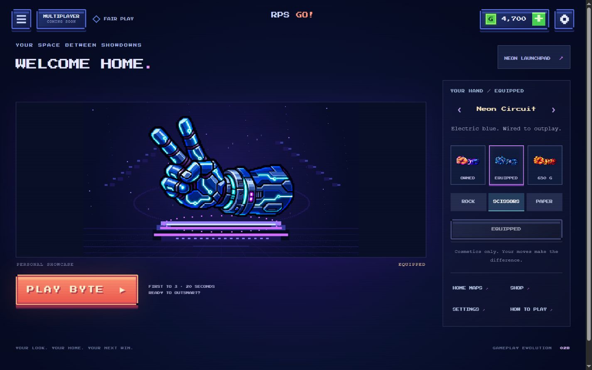
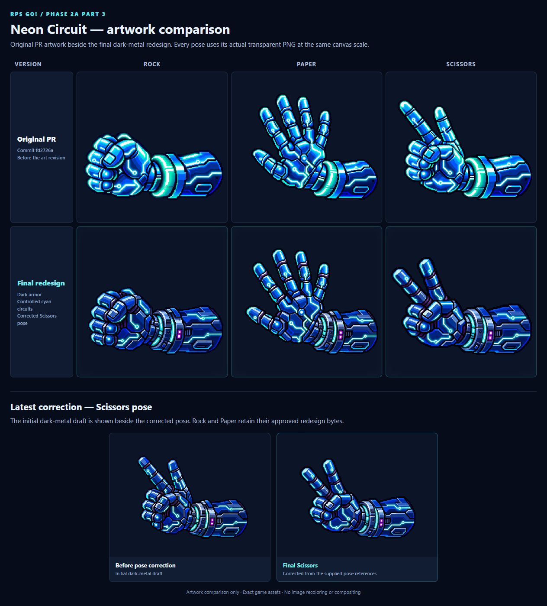

# Neon Circuit artwork revision and Scissors correction

This revision updates PR #4 on `codex/phase-2a-part3-playtest-premium-skins`. It includes the requested dark-metal Neon redesign and the subsequent Scissors pose correction. It does not merge the pull request or deploy production.

## Final artwork

All three Neon poses now have broad navy/cobalt armor surfaces, steel-blue bevels, deep violet joint recesses, deliberately routed cyan channels, and a mechanical power collar with a recessed cyan ring and two small magenta indicators. The art was redrawn with the built-in image generation tool, not produced by applying a color filter.

The final Scissors correction follows the orange pose reference supplied by the creator (the actual attachments arrived in the reverse order from their earlier description). The raised index and middle fingers form a clear separated V. Two compact folded fingers sit lower beneath a natural diagonal thumb. The extra stacked finger-like shapes from the rejected draft were removed. The cuff, palette and cybernetic identity remain consistent with Rock and Paper.

Rock and Paper are byte-identical to the dark-metal redesign the creator reviewed before requesting the pose fix:

- Rock SHA-256: `2e841afbd8fbc3ab89d2de3d817447a77d1e94423d8b354b9495ea6f5b5dd19a`
- Paper SHA-256: `af981b54eaf9600ea3d744d03535e693fb31b50e66dba0a33409ecb319ba4352`

## Runtime integration and preservation

The three filenames and `neon-circuit` skin ID remain the same. Existing owners receive the art automatically without another purchase. The price remains 300 coins.

All images are transparent 768 × 768 RGBA PNGs. The generated artwork was mechanically cropped and fitted with nearest-neighbor sampling; only near-invisible alpha values at or below 8 were removed. No color adjustment, painting, or mirroring was used in runtime preparation. Right/bottom registration remains 748/655; the final Scissors bounds are [24,155,748,655]. No fingertips, cuffs, or forearms touch the canvas border.

The existing shared image cache and draw functions supply the arena, reveals, home, shop, thumbnails, gesture buttons, Sike Out cards and submitted claim icon. Only the registry crop bounds changed in runtime JavaScript. Failed/loading images still use the existing procedural fallback.

All nine Classic/BYTE/Solar Flare PNGs are byte-identical to their approved versions. No changes were made to match logic, timer, first-to-three rules, BYTE decisions, charge/refund/expiration rules, economy, save keys, prices, maps, SHOOT VFX, audio, history, settings, layout or accessibility behavior.

## Actual verification

- `node --test`: **70 passed; 0 failed, skipped or cancelled**.
- `node scripts/build.mjs`: **passed**.
- `git diff --check`: **passed**.
- Three new regressions decode actual PNG alpha bounds and compare both metadata locations; verify all nine protected sprite hashes; and round-trip an existing owned/equipped Neon save without repurchase, currency, settings, tutorial or map changes.
- Existing tests continue to cover preload failures/timeouts, fallback, positive image draws without mirroring, disabled image smoothing, icon aspect ratios, timing, Sike Out rules, scoring, economy and saves.
- Chromium browser verification at **1440 × 900**, **390 × 844** and **320 × 740**. All three final arena poses were exercised. Corrected Scissors was inspected in desktop/mobile arena, home, shop, gesture thumbnail and Sike Out card views.
- Tested purchase/equip in an isolated session save: 5,000 became 4,700; ownership, equipped Neon and the 4,700 balance survived reload. The creator's real localStorage was not modified.
- Exercised ordinary move selection/locking, shake/SHOOT/reveal, a win, a loss and a tie across successive rounds using the existing isolated review harness. Sike Out submission and cancellation were exercised. The harness controls the clock and BYTE for screenshot reproducibility; it does not ship in the production build.
- No warning/error console entries observed in the final browser review. Measured mobile document widths did not exceed the requested viewports.

No physical-device, Safari/Firefox or screen-reader testing is claimed. Visual quality remains subject to the creator's final approval. No known artwork-loading or gameplay regression remained in these checks.

## Screenshots

These are actual game UI screenshots. QA controls can be visible below the application or in the selector because the screenshots use the existing isolated review copy.

| Arena pose | Desktop |
| --- | --- |
| Rock | [View](neon-revision-screenshots/rock-arena-desktop.jpg) |
| Paper | [View](neon-revision-screenshots/paper-arena-desktop.jpg) |
| Corrected Scissors | [View](neon-revision-screenshots/scissors-arena-desktop.jpg) |

- [Scissors mobile arena](neon-revision-screenshots/scissors-arena-mobile.jpg)
- [Scissors mobile home](neon-revision-screenshots/home-scissors-mobile.jpg)
- [Scissors shop](neon-revision-screenshots/shop-scissors-desktop.jpg)
- [All three Sike Out cards](neon-revision-screenshots/sike-selector-desktop.jpg)
- [390px cards](neon-revision-screenshots/sike-selector-mobile.jpg)
- [320px cards](neon-revision-screenshots/sike-selector-320.jpg)
- [Rock home and skin thumbnails](neon-revision-screenshots/home-desktop.jpg)
- [Paper home](neon-revision-screenshots/home-paper-desktop.jpg)
- [Paper shop](neon-revision-screenshots/shop-desktop.jpg)

## Before and after

The comparison below is a labeled browser-rendered sheet of the actual PNG files, not an arena screenshot. It compares the original PR assets at `fd2726a` with the final redesign, then separately shows the rejected dark-metal Scissors draft beside the corrected pose. All PNGs use equal canvas scale.

## Modified and added files

- Replaced: `assets/hands/part3/neon_circuit_rock.png`, `neon_circuit_paper.png`, `neon_circuit_scissors.png`.
- Updated: `assets/hands/part3/manifest.json` and `src/render/hand-assets.js` (bounds/provenance only).
- Added: `tests/neon-revision.test.js`.
- Updated review index: `docs/phase-2a-part3-review.md`.
- Added: this report, [exact generation prompts](neon-circuit-art-prompts.md), and `docs/neon-revision-screenshots/`.

Generated masters, comparison HTML/source copies and QA output stay in ignored local folders. Only the selected game-ready art and review evidence are committed.

## Local preview

Run `node scripts/serve.mjs`, then open http://127.0.0.1:8000/ on this computer. Refresh a previously open game tab so its image cache loads the new PNGs. For isolated review controls run `node scripts/part3-review.mjs` and open /output/part3-review/. No production deployment is part of this revision.
