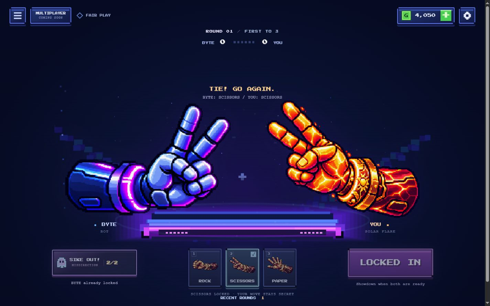
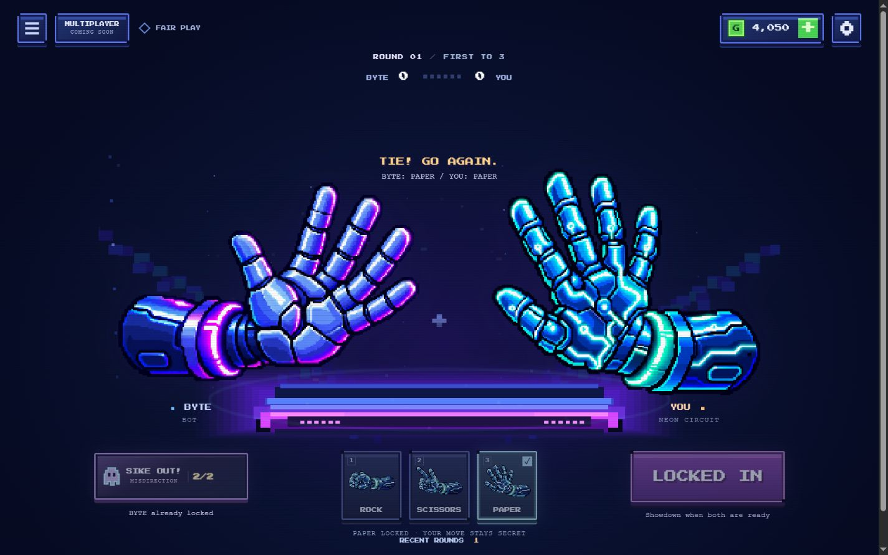
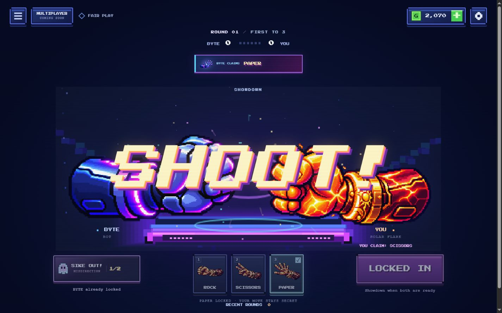

# Phase 2A Part 3 — implementation and review

Latest art revision: [Neon Circuit dark-metal redesign and corrected Scissors pose](neon-circuit-revision.md), with refreshed screenshots, before/after comparison and 70 passing tests. The original implementation screenshots below remain historical evidence for the broader Part 3 update.

Branch: `codex/phase-2a-part3-playtest-premium-skins`. Base: merged main `3d3cf1b0554e222fcd070037504a3f521cea45ea` (includes PR #3). This update is prepared for review, not merged or deployed.

## Implemented

- **Premium skins:** six new original transparent 768×768 PNGs. Neon Circuit has cyan/mint circuit plating and a teal cuff; Solar Flare has molten armor, engraved gold solar cuffs and crimson sleeves. Shared 12-image registry supplies matches, gesture controls, bluff cards, home, shop and thumbnails. The original six Classic/BYTE PNGs are byte-identical to main (SHA-256 regression coverage). No PNG is mirrored at runtime.
- **Pre-lock bluff fairness:** BYTE locking strictly before the round deadline refunds an open reservation atomically, closes the selector, announces the refund and rejects stale submission. Opening after BYTE locks is forbidden. A genuinely unresolved selector at the deadline still consumes one charge exactly once. Chronological ordering also applies after a large clock jump. Refunded charges never count toward loss fees.
- **Shorter waits:** confirming a hand advances BYTE's pending lock to a randomized 1–3 seconds, retaining an earlier planned lock and respecting the original 20-second deadline. The bot's input remains prior revealed history plus legitimate public claims. Secret choices are immutable and remain private until reveal.
- **Incoming claim:** full neon alert centered over the countdown, 100px artwork, exact spectral taunt and explicit BYTE CLAIMS label. The clock continues underneath. Its full visibility remains 5,500ms; early readiness compacts it immediately through SHOOT. Exit, duplicate guards, new-round/navigation cleanup and reduced motion remain intact. The theatrical line does not prove whether the claim is true.
- **Controls and cards:** bottom-left ghost ability with charge count, pending/ready/used/disabled feedback; centered move controls and nearby right-side SHOOT; larger premium amber/cyan/magenta cards with equipped art, stagger, hover lift, ornaments and brief particles. A valid claim produces a skin-aware confirmation flash/burst. Cosmetic animation never pauses gameplay.
- **Cinematic sequence:** existing three hand-shake beats retained. Deterministic platform pulses, pixel sparks, directional streaks, cyan/violet shockwaves, restrained flash, bounded canvas-only shake and large layered SHOOT typography. At most 48 particles, reduced to 18 on small canvases; reduced motion suppresses intense effects. Effects derive from match timestamps and retain no particle/timer state across rounds.
- **Audio:** four original local tonal preview WAVs with preload/decode, gesture unlock, one-cue polyphony, stop/abort, missing-file fallback and once-per-beat tracking. Global mute plus independent saved SFX/announcer cue volumes. These are **synthesized previews, not spoken or professional announcer recordings**. Authorized spoken clips can replace the mappings without changing gameplay.
- **Round history and accessibility:** last six completed rounds show actual revealed moves, separate public claims, win/loss/tie and auto-picks. Independent of BYTE's five-move strategy history; resets on rematch. Keyboard 1/2/3 remains Rock/Scissors/Paper; Enter/Space lock only with appropriate gameplay focus. Modal focus restores, status messages announce changes, hints and cosmetic text are larger. The home showcase scales with viewport height so PLAY BYTE is visible on a short desktop.

## Preserved behavior and saves

First to three total wins; ties award no points and may extend beyond five rounds. Two bluff charges per side; one spent attempt per round. Eligible victory +120; completed defeat −25 per submitted/expired player charge, clamped to wallet. No abandonment settlement. Skin prices remain 300/650 and map prices remain 0/700/1,400.

Save key remains `rpsgo.save.v2`; v1 fallback/backup behavior is unchanged. Coins, owned/equipped skins and maps, tutorial and existing preferences are retained. Volume fields are additive, finite and clamped to 0–1, with defaults .7/.6. Players who already own premium skins see the artwork upgrade automatically. No Plus 1!, multiplayer networking, account system, paid service or new dependency.

## Artwork files and provenance

All runtime files are in `assets/hands/part3/`:

| Family | Rock | Paper | Scissors |
|---|---|---|---|
| Neon Circuit | [PNG](../assets/hands/part3/neon_circuit_rock.png) | [PNG](../assets/hands/part3/neon_circuit_paper.png) | [PNG](../assets/hands/part3/neon_circuit_scissors.png) |
| Solar Flare | [PNG](../assets/hands/part3/solar_flare_rock.png) | [PNG](../assets/hands/part3/solar_flare_paper.png) | [PNG](../assets/hands/part3/solar_flare_scissors.png) |

Created with the built-in image generation tool using the creator's supplied aesthetic references and approved player-hand registration. Each pose was generated as original pixel artwork, not recolored procedural geometry. Family prompts specified detailed segmented fingers/knuckles, inward facing silhouettes, matching cuffs, transparent backgrounds, and crisp pixel shading. Generated masters remain local and are not published. The manifest records their source basenames and final bounds.

Mechanical production cleanup removed near-invisible alpha values ≤8, cropped to visible bounds, then fitted with nearest-neighbor sampling onto 768px transparent canvases. Maximum visible widths are 724px; target heights are 349/547/516 for rock/paper/scissors. Right and bottom anchors are 748 and 655. Full fingers and cuffs remain in bounds. Approved Classic/BYTE originals were never processed. Procedural art is only a nonblocking loading/error fallback. Final art quality is ready for creator review.

## Files changed

- `index.html`, `src/main.js`, `src/config.js`: layout wiring, presentation events, volumes, history, timing configuration, keyboard/focus/status integration.
- `src/core/match.js`, `src/core/storage.js`: atomic refund ordering, accelerated readiness, visible history and additive settings validation. Existing bot/economy/perk modules remain unchanged.
- `src/render/hand-assets.js`, `src/render/arena.js`, new `src/render/effects.js`: premium registry and deterministic VFX. Existing shared hand drawing paths remain unchanged.
- `src/ui/bluff-alert.js`, `src/ui/sound.js`, new `src/ui/announcer.js` and `src/ui/round-history.js`.
- New `src/styles/part3.css`: organized additive visual/responsive/accessibility styles; previous styles retained.
- `assets/hands/part3/`: six PNGs and manifest. `assets/audio/`: four WAVs and honest integration notes.
- `tests/game.test.js`, `tests/hand-art.test.js`, `tests/bluff-alert.test.js`; new `tests/part3-core.test.js`, `tests/part3-presentation.test.js`, `tests/approved-hand-hashes.json`.
- `scripts/part3-review.mjs`, `scripts/create-audio-previews.mjs`, WAV MIME support in `scripts/serve.mjs`, README and these review artifacts.

## Verification performed

**67/67 Node tests passed**, zero failed/skipped. Production build passed. Diff whitespace checks passed after correction. Coverage includes original rules/economy/migration/asset fallback tests plus lock/refund/expiry millisecond boundaries, simultaneous deadline jumps, 1–3s readiness bounds, private move isolation, record publication/capping, deterministic reduced-motion VFX, cue deduplication/abort/failure, WAV validity, volume validation and original asset hashes.

Browser review used Chromium in the Codex in-app browser at **1440×900, 1366×768, 768×1024, 390×844 and 320×740**. A generated copy runs the actual UI and engine with an injected clock/bot and a separately named session-storage save initialized to 5,000 coins. QA controls visible in some screenshots are confined to ignored `output/`; they do not ship. The creator's real localStorage was never used for purchases or gameplay tests.

Verified in the browser:

- Classic/BYTE and both premium skins in all three actual arena reveal poses; distinct skin silhouettes and correct orientation.
- Both premium skins' three home and shop pose controls, direct selection, previous/next carousel, locked preview, purchase and equip. 300+650 skin purchases plus 700+1,400 map purchases left exactly 1,950 from 5,000; all ownership, equipped Starlight Hangar/Solar Flare and balance survived reload.
- Pending selector closed at BYTE lock with 2/2 restored; true deadline scenario showed 1/2 and no submitted claim. Valid claim used one charge. Keyboard selection/Enter locked the chosen hand.
- Full centered alert, early-ready compact claim through SHOOT, reveal cleanup, fresh-round state; no gameplay delay from alert duration.
- Reduced-motion showdown, settings saved as SFX .35 / cue .4 after reload, first-to-three 3–0 victory awarded +120 (balance 2,070), and RETURN HOME worked.
- Recent-round dialog contained only completed actual hands and clearly labeled claims; Escape returned focus. Narrow selector fit inside 320px viewport. Main controls/history fit the 390×844 view. No horizontal document overflow in measured views.
- At 1366×768 from scrollY=0, PLAY BYTE ended at y≈720, fully within the viewport; customization remained normally scrollable.
- Separate production-build smoke copy changes only storage to sessionStorage; it uses the real bot and live clock. Welcome/tutorial and real selection/locking were exercised; the match subsequently completed with a victory, automatically returned home, and showed exactly 120 coins from a zero starting wallet. [Live-build evidence](part3-screenshots/production-victory-home.jpg).
- No error/warning console entries observed during the isolated functional review.

No claim of physical-device, Safari/Firefox, measured frame-rate/battery benchmarks, screen-reader software testing or audible voice-quality testing is made. Voice recordings are intentionally absent; the provided fallback meets the specification. No known gameplay regression remained in the executed checks.

## Screenshots

Screenshots are actual game UI. Deterministic QA controls can appear below the game or at the bottom of the selector. Full-resolution PNG artwork is linked above.

| Arena poses | Rock | Paper | Scissors |
|---|---|---|---|
| Classic + BYTE | [View](part3-screenshots/classic-rock-arena.jpg) | [View](part3-screenshots/classic-paper-arena.jpg) | [View](part3-screenshots/classic-scissors-arena.jpg) |
| Neon Circuit | [View](part3-screenshots/neon-circuit-rock-arena.jpg) | [View](part3-screenshots/neon-circuit-paper-arena.jpg) | [View](part3-screenshots/neon-circuit-scissors-arena.jpg) |
| Solar Flare | [View](part3-screenshots/solar-flare-rock-arena.jpg) | [View](part3-screenshots/solar-flare-paper-arena.jpg) | [View](part3-screenshots/solar-flare-scissors-arena.jpg) |

- Home: [Neon desktop](part3-screenshots/neon-home-desktop.jpg), [Solar 1366×768](part3-screenshots/solar-home-1366.jpg), [tablet](part3-screenshots/home-tablet.jpg).
- Shop: [Neon](part3-screenshots/neon-shop-desktop.jpg), [Solar](part3-screenshots/solar-shop-desktop.jpg).
- Cards: [Neon desktop](part3-screenshots/neon-selector-desktop.jpg), [Solar desktop](part3-screenshots/solar-selector-desktop.jpg), [mobile](part3-screenshots/selector-mobile.jpg), [320px](part3-screenshots/selector-320.jpg).
- Incoming claim: [desktop](part3-screenshots/incoming-full-desktop.jpg), [mobile](part3-screenshots/incoming-full-mobile.jpg), [mobile SHOOT/compact](part3-screenshots/shoot-compact-mobile.jpg).
- [History](part3-screenshots/round-history-desktop.jpg) and [reduced-motion tablet](part3-screenshots/reduced-motion-tablet.jpg).

## Preview and release

Run `node scripts/serve.mjs`, open `http://127.0.0.1:8000/`. For isolated scripted review first run `node scripts/part3-review.mjs`, then open `/output/part3-review/`. Run `node --test` and `node scripts/build.mjs`; `dist/` excludes design references, raw masters, QA controls and review screenshots.

After creator approval, merge the PR and let the existing GitHub Pages main-branch deployment publish it. This task does not merge or change the live release. Spoken announcer recordings can be supplied later through the documented four asset mappings; no gameplay work depends on them.
