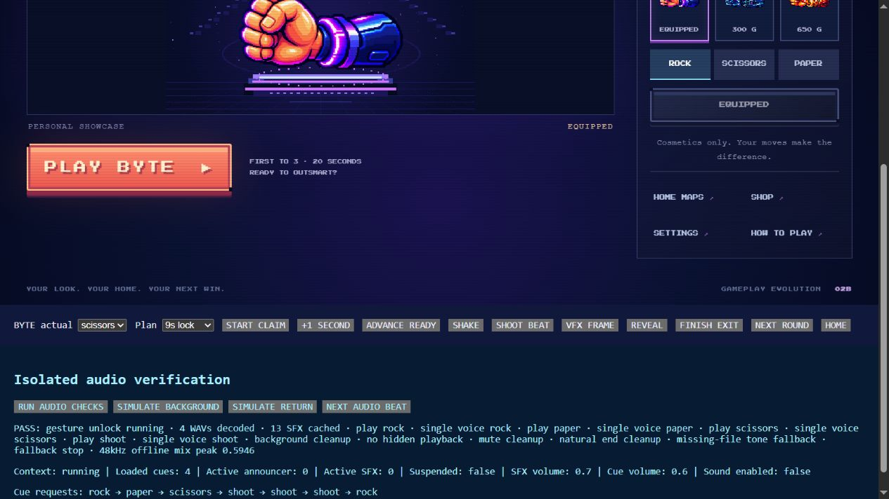
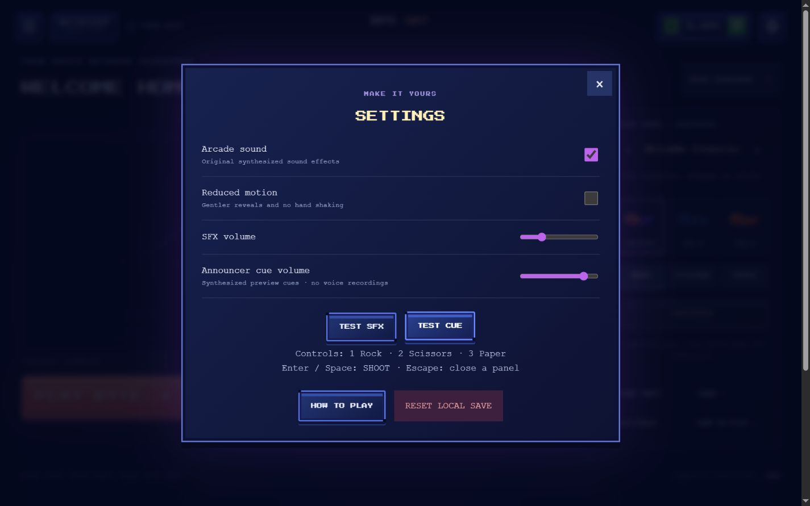
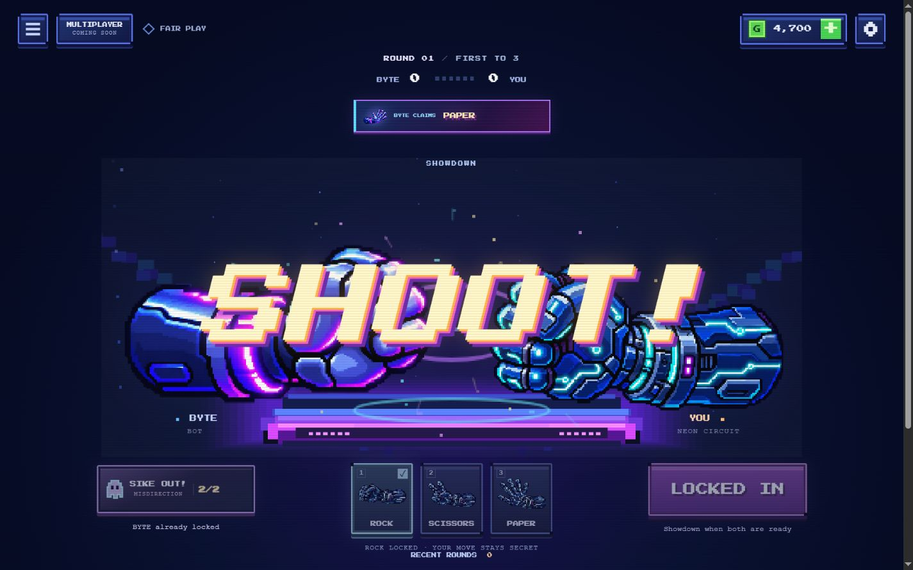
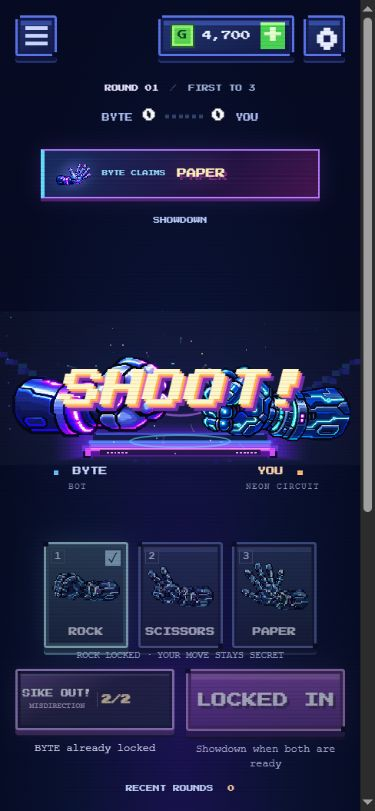
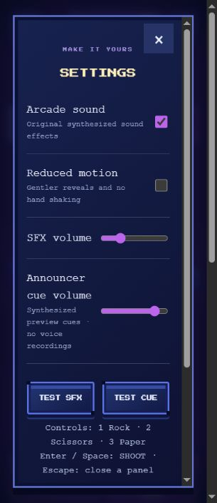

# Phase 2A release and Phase 3 audio review

## Approved Phase 2A release

PR [#4](https://github.com/HeroCraft360/rps-go/pull/4) was merged normally after verifying its exact approved head `d50856ceb3a230acbb1d2e88336cb930dcf48ab5`. No later commits or conflicts were present; no unnecessary pre-release commit was made.

- Merge commit and updated main: `cfba884bd69619f2b954f2a5af3ced566917f787`.
- Final release checks: 70/70 Node tests, production build, clean working tree and diff checks passed.
- No repository PR CI workflows were configured. GitHub's built-in [Pages build/deployment #5](https://github.com/HeroCraft360/rps-go/actions/runs/40534445477) succeeded in 49 seconds.
- Deployment carried a GitHub-managed action Node runtime deprecation warning and runner-image notices; all jobs succeeded.
- [Live game](https://herocraft360.github.io/rps-go/) loaded successfully. All 12 deployed hand PNGs returned HTTP 200 and matched the approved local SHA-256 hashes.
- A normal live match reached a 3–1 player victory, awarded 120 GO Coins and returned home. Sike Out cards, SHOOT, Neon Scissors and Solar home previews were checked. No browser warnings/errors were observed.

## Audio milestone status

**PARTIAL: the supported audio-engine and SFX improvements are implemented; the four original spoken recordings remain missing.** No voice-generation tool was available. No paid service, commercial recording, sampled voice, or recognizable-actor imitation was used. The existing four tonal WAVs are explicitly labeled previews in settings and documentation.

Branch: `codex/phase-3-arcade-announcer`, based on the verified release above. This update is for review and must not merge automatically.

## Implemented

- Separate original Rock bass/mechanical thump, Paper electric pulse and Scissors rising accent. SHOOT combines a transient, bass drop, electric burst, sweep and short tail.
- Thirteen cached procedural effects: click, select, lock, rock, paper, scissors, shoot, bluff activation, incoming claim, submitted claim, win, loss and coin. Deliberately no hover spam.
- Effects synthesize incrementally during page load, yielding between short buffers; user-gesture unlock only creates the context and caches ready PCM. Playback never waits for synthesis or downloads.
- Central audio configuration derives beat spacing from existing gameplay timing: 450/450/450 ms and 700 ms for SHOOT. The cue tracker emits once for the actual current beat and does not queue missed beats.
- Optional spoken URLs are null until files exist. The loader prefers an enabled recording, falls back to the local preview on failure, and uses a short independently controlled tone if neither can load. Five-second fetch/decode timeout; cached buffers; no playback when a late request completes.
- One active announcer and at most four SFX groups. Sources and gains disconnect on completion, replacement, mute, background, navigation and rematch. Audio has no effect on reveal scheduling.
- Global mute stops active sounds immediately. Independent saved SFX and announcer sliders affect active gain and preserve all existing save fields. TEST SFX and TEST CUE buttons provide direct feedback.
- Background return consumes the current cue and drains overdue public events while audio remains suspended; later beats follow the normal clock. No backlog of announcements or public-claim sounds is replayed.
- Conservative source scaling leaves headroom even for four maximum-volume effects plus one full-scale voice. Existing tonal WAVs are unchanged; no new runtime audio download is required.

## Assets and provenance

The existing `rock-preview.wav`, `paper-preview.wav`, `scissors-preview.wav` and `shoot-preview.wav` total 51,772 bytes and remain mono 22.05 kHz/16-bit PCM. They are original synthesized tones from `scripts/create-audio-previews.mjs`, not speech. New supporting SFX are original repository synthesis code in `src/ui/sfx-design.js`, cached at 22.05 kHz and resampled by Web Audio.

Missing files: `announcer_rock.wav`, `announcer_paper.wav`, `announcer_scissors.wav`, `announcer_shoot.wav`. The [recording kit](announcer-recording-kit.md) supplies exact scripts, cohesive performance direction, timing limits, 44.1/48 kHz delivery guidance, processing suggestions, permission/provenance fields and integration instructions. [Manifest](../assets/audio/manifest.json) distinguishes missing voices, existing fallback hashes and procedural effects. Future recordings need a verified usage basis and creator approval.

## Files

| File | Purpose |
| --- | --- |
| `src/ui/audio-config.js` | Central timing/mix limits and optional voice/fallback URLs |
| `src/ui/announcer.js` | Cache, timeout/fallback, single-cue playback and lifecycle cleanup |
| `src/ui/sfx-design.js` | Original deterministic PCM synthesis and peak control |
| `src/ui/sound.js` | Incremental preparation, cached playback, bounded voices, mute/cleanup |
| `src/main.js` | Beat wiring, specific UI sounds, settings tests and background lifecycle |
| `src/ui/bluff-alert.js` | Distinct incoming-claim sound; notification behavior unchanged |
| `tests/audio.test.js` | New audio lifecycle, synthesis, real match timing and save regressions |
| `tests/bluff-alert.test.js`, `tests/part3-presentation.test.js` | Updated sound identity and scheduled-stop mock semantics |
| `scripts/audio-review.mjs` | Isolated browser QA extension; never included in dist |
| `assets/audio/README.md`, `assets/audio/manifest.json` | Status, metadata and provenance |
| `docs/announcer-recording-kit.md` | Missing voice production handoff |
| `docs/audio-screenshots/`, this report, `README.md` | Review evidence and instructions |

No changes to core gameplay, economy, save schema, hand sprites, maps, CSS, or arena/VFX rendering.

## Verification

- **82/82 automated tests passed**, including all 70 existing tests. New checks exercise optional voices, decode/fetch failures and timeout, no late replay, single-cue playback, bounded SFX, immediate mute, independent active gains, natural/explicit cleanup, background suppression, blocked audio, deterministic unclipped effects, early-ready/deadline cue boundaries, ties/new rounds/rematches and unchanged saved inventory/settings.
- **Production build passed.** QA toolbar, reports and screenshots are excluded from dist; relative module/asset URLs remain compatible with GitHub Pages.
- Chromium Web Audio check: context unlocked from a click; four actual WAVs decoded; all 13 effects cached; each cue played with one active announcer; background/mute/natural-end cleanup passed; injected unavailable files used the controllable tone fallback. A real 48 kHz OfflineAudioContext stress mix of four simultaneous SHOOT effects plus the preview cue peaked at **0.5946**, below clipping.
- In-game browser review: requested cue order was Rock → Paper → Scissors → Shoot once per beat. Checked incoming/full and compact claims, reduced-motion reveal, a tie, successive rounds, Sike Out submission and simulated background/return through the same application handler.
- Changed SFX to 0.25 and cue volume to 0.85 using keyboard-accessible sliders; reloaded and verified both values and sound-enabled state persisted. Global mute left both active source counts at zero. Neon ownership/equipment remained intact in the isolated session save.
- Requested viewports **1440×900, 1366×768, 768×1024, 390×844 and 320×740** were verified. No horizontal overflow; small screens use normal vertical scrolling. Inspected SHOOT/compact-claim layout at all five sizes and settings at desktop/320px. Mobile settings remain scrollable and accessible.
- Browser test data is isolated: the review copy uses a controlled clock, fixed BYTE hand and session-only save. Background simulation is explicitly a QA button invoking the real lifecycle handler, not a physical-device background test.

## Screenshots

Additional images: [1366px SHOOT](audio-screenshots/shoot-1366.jpg), [tablet SHOOT](audio-screenshots/shoot-768.jpg), [320px SHOOT](audio-screenshots/shoot-320.jpg), [incoming claim](audio-screenshots/incoming-1440.jpg), [reduced-motion reveal](audio-screenshots/reduced-reveal-768.jpg).

## Limitations and next step

No final spoken performance exists yet; the milestone remains partial until those four recordings are produced, approved and integrated. Browser checks verify decoding, rendered samples, lifecycle and synchronization—not a human assessment of perceived voice/SFX quality. No physical phones, Safari/Firefox, speaker/headphone listening session, formal frame-rate benchmark or latency measurement was performed. Review the playable sound design and recording direction before approving the new PR.

A separate smoke test also used the unmodified production build at `http://127.0.0.1:8001/` with the real game clock, normal BYTE decisions and normal storage on that separate origin. Manual moves and deadline auto-picks completed a match, the game returned home with 120 coins, and the console contained no warnings/errors. [Production-build home](audio-screenshots/production-build-home.jpg). No QA toolbar is present in this preview.
