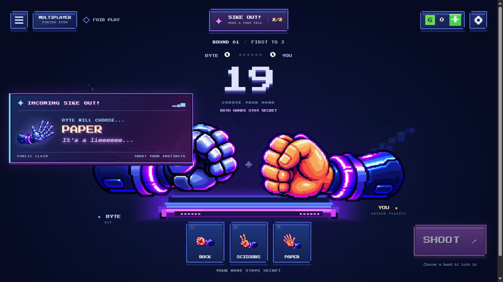
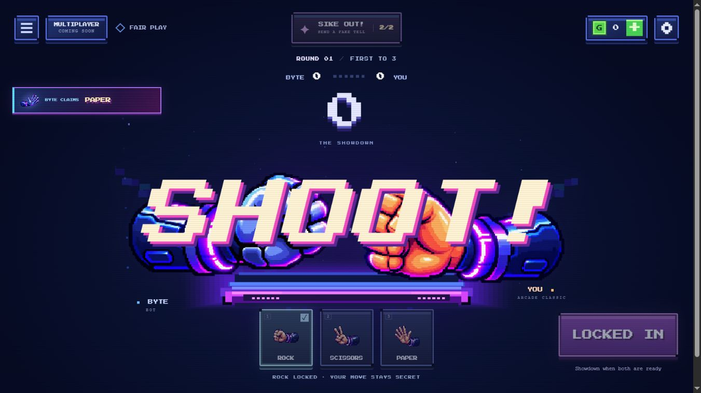
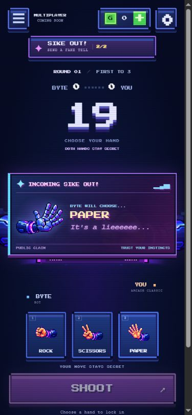
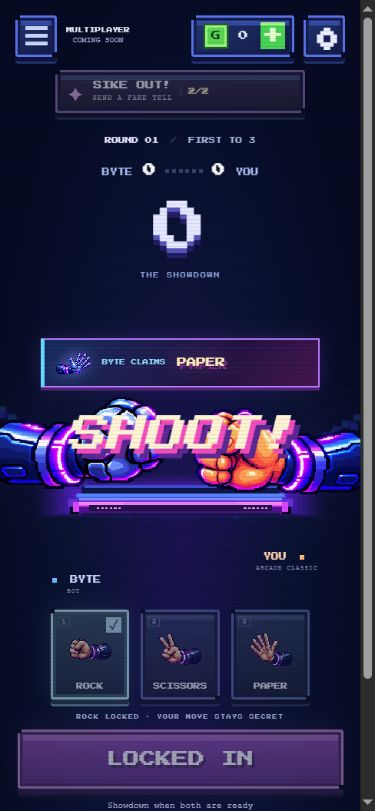
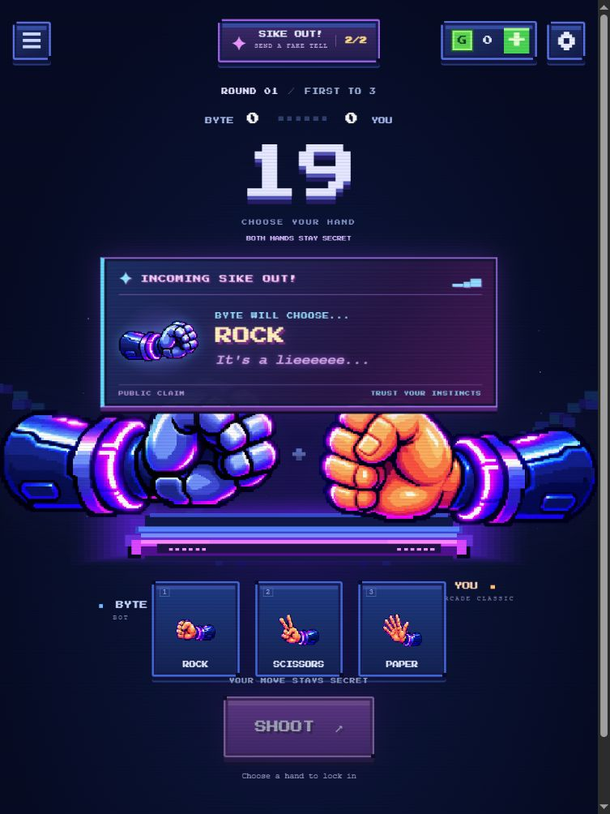

# Sike Out! notification upgrade — review report

Branch: `codex/sike-out-notification-polish`. Prepared October 25, 2026 for review; not merged into `main`.

## Implemented

- Full incoming BYTE claim stays visible for **5,500ms**, followed by a **220ms** exit. The desktop card is 500px wide with a 100px hand canvas; phones use a responsive card and 96px canvas.
- Purple, blue and magenta neon borders, pixel typography, a single low-opacity entrance flash, scale/card-slam entrance, spectral floating text and fade/scale exit.
- Required copy: **INCOMING SIKE OUT!**, **BYTE WILL CHOOSE...**, the public hand name and illustration, and **It's a lieeeeee...**.
- If readiness arrives while the card is visible, it becomes a compact **BYTE CLAIMS** indicator through BOTH_READY, HAND_SHAKE and SHOOT_OVERLAY. Reveal starts its exit. No match phase waits for the notification.
- Removed the old BOTH_READY clearing behavior and the duplicate BYTE nameplate claim. The alert lives below dialogs and never intercepts pointer input.
- Explicit cleanup on home navigation, match completion and a new round. Duplicate, malformed, future and stale public events cannot replay the alert. Same-frame tell/readiness events render compact immediately.
- Existing reduced-motion settings disable entrance, ghost text, flash and transitions; cleanup becomes immediate without shortening the full readable duration.

## Boundaries preserved

Only public tell events and phase/round metadata reach the alert. BYTE's secret lock is not read. The 20-second deadline, first-to-3 rules, bot decisions, Sike Out! charges, economy, saves, skins and six approved PNG files are unchanged. There are no new dependencies, services or networking features.

The presentation clock uses the match's clock after its update, avoiding a small RAF timestamp mismatch that could otherwise reject a newly scheduled event as being in the future.

At widths up to 1200px, the card sits below the timer and the arena has a 680px minimum height. Short phone screens scroll vertically so controls and the alert remain separate. The compact claim occupies that reserved upper-arena area and leaves SHOOT clear. A full-size card may overlap decorative hands while choosing.

## Validation

- `node --test`: **53 passed, 0 failed**. Eight notification tests cover exact duration boundaries, exit, early readiness, same-frame events, invalid/stale events, duplicates, reduced motion, cleanup and successive rounds. The real match-engine test also checks private locks, phase timing and perk charges.
- `node scripts/build.mjs`: passed; packaging includes only game code and assets.
- `git diff --check`: passed.
- In-app Chromium browser: checked desktop 1366×768, tablet 768×1024, phone 390×844 and narrow phone 320×568. No horizontal overflow or notification overlap with move/SHOOT controls at the narrow width.
- Verified full alert at 5 seconds, animated expiry after its deadline, compact claim during SHOOT, and cleanup after reveal. Tested Rock, Paper and Scissors public claims.
- Verified reduced-motion computed animations are `none` for the card, ghost text and decorative flash. Found and fixed the flash pseudo-element initially escaping the global reduced-motion rule.
- No browser warnings or errors were captured during the review flow.

Screenshots use an isolated copy of the actual game UI and match engine with a controlled clock, scripted BYTE and in-memory progress. This keeps captures reproducible without changing the production bot or touching player storage. CSS animations still run normally. Physical iOS/Android devices and Safari/Firefox were not tested. No known functional issues remain from these checks.

## Screenshots

Desktop incoming claim:

Desktop compact claim during SHOOT:

Mobile incoming claim:

Mobile compact claim during SHOOT:

Tablet incoming Rock claim:

## Files and preview

Production: `src/config.js`, `src/ui/bluff-alert.js`, `src/styles/phase2b.css`, `src/main.js`, `index.html`.

Verification/documentation: `tests/bluff-alert.test.js`, `scripts/bluff-review.mjs`, this report and its screenshots, `README.md`.

Run `npm start` and open `http://127.0.0.1:8000/` for normal gameplay. For reproducible review, first run `node scripts/bluff-review.mjs`, then open `http://127.0.0.1:8000/output/bluff-review/`. Controls below the game start a public claim, advance seconds, trigger early readiness and step through SHOOT/reveal/exit. Review output is ignored by Git and excluded from the production build.

Ready for review: notification styling, duration, compact transition, reduced motion, responsive placement and cleanup. Merge and GitHub Pages publication remain pending approval.
